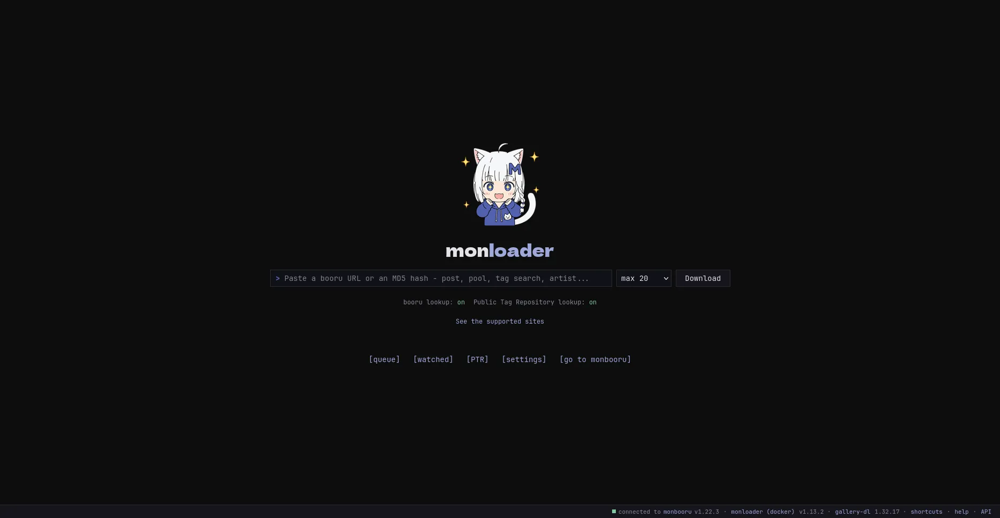
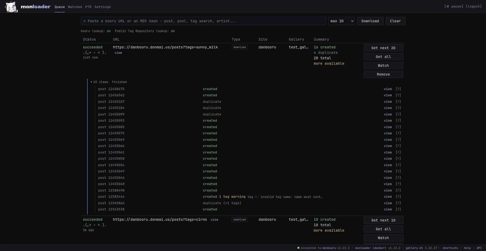
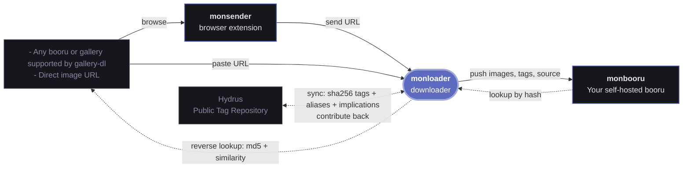

# monloader

Download images from the web into [monbooru](https://github.com/monbooru/monbooru), and find tags for the files already in it.

Paste a URL from a booru, a gallery, [any site gallery-dl supports](https://github.com/mikf/gallery-dl/blob/master/docs/supportedsites.md), or a direct image link: monloader fetches the files with their tags, rating and source, and pushes them into a monbooru gallery. For a file monbooru already holds, it looks up tags by md5 or image similarity (IQDB, SauceNAO) on the boorus, or in an optional local copy of the [Hydrus Public Tag Repository](https://hydrusnetwork.github.io/hydrus/PTR.html).

monloader never touches your files directly: everything goes through monbooru's API, and it can add images and tags but never delete anything.

**[Documentation](https://monbooru.github.io/mondocs/addons/monloader/index.html)** · **[Install](#install)** · **[Releases](https://github.com/monbooru/monloader/releases)** · **[Changelog](CHANGELOG.md)**

<table>
  <tr>
    <td></td>
    <td></td>
  </tr>
</table>

## Features

- **Download** a booru post, pool, tag search or artist page, or a direct image link
- **Pools and manga**: a booru pool imports as an ordered collection; a manga or comic gallery becomes one `.cbz` for monbooru's reader
- **Tags mapped to monbooru**: tags by category (artist, character, copyright, meta...), rating and source, normalized across booru families
- **50+ site profiles** for boorus and manga/comic sites; every other gallery-dl site works through a generic fallback
- **Update gallery-dl** from the app, or roll it back, when a site fix lands, without waiting for a monloader release
- **Queue** that shows whether each item was added, already in your library, skipped, or failed
- **Watched searches**: save a tag search or an artist page and monloader checks it on a schedule, fetching only new posts
- **Reverse lookup**: exact md5 searches on the boorus, IQDB and SauceNAO similarity lookups for re-encoded copies, and offline sha256 lookups in an optional local copy of the Hydrus PTR (needs tens of GB of disk)

## Related applications

monloader is a companion downloader for monbooru. It fetches images from the web and pushes them into your library:



- **[monbooru](https://github.com/monbooru/monbooru)**: self-hosted booru; organizes, tags, and serves your collection.
- **monloader**: this application; fetches files and per-post metadata (via gallery-dl) and pushes them into a monbooru gallery over the REST API; also answers monbooru's reverse lookups (boorus, IQDB/SauceNAO, Hydrus PTR) and source refetches.
- **[monsender](https://github.com/monbooru/monsender)**: browser extension; sends the URL of the page you're browsing to monloader.

## Install

monloader runs on Linux (x86_64, arm64) and Windows (x86_64), and needs a running monbooru. Once started, it's at `http://localhost:8456`.

### Docker

monbooru's [`docker-compose.yml`](https://github.com/monbooru/monbooru/blob/main/docker/docker-compose.yml) already includes monloader:

```bash
docker compose up -d monloader
```

### Download

Download a build for your system from the [releases](https://github.com/monbooru/monloader/releases), unpack it, and run it.

- **lite** expects gallery-dl to be installed.
- **bundled** brings its own gallery-dl.

Beside the portable archives, Windows builds also ship as an installer, Linux bundled builds as an AppImage and as a Flatpak, and Arch has the `monloader` AUR package.

### Pair it with monbooru

1. In monloader's **Settings**, check the **API URL** under **monbooru**. The default, `http://monbooru:8455`, is right when both run from monbooru's compose file.
2. Under **Pairing**, click **Connect to monbooru**, then approve the request in monbooru under **Settings → Plugins**.
3. Back in monloader, pick the **Default gallery** and save.

Then paste a URL into the add bar on the home page.

## Warning

> **Intended for local network use.** monloader's UI is not designed to be exposed to the public internet.

## License

[AGPL-3.0](LICENSE).

## Acknowledgements

See [monbooru's acknowledgements](https://github.com/monbooru/monbooru#acknowledgements).
